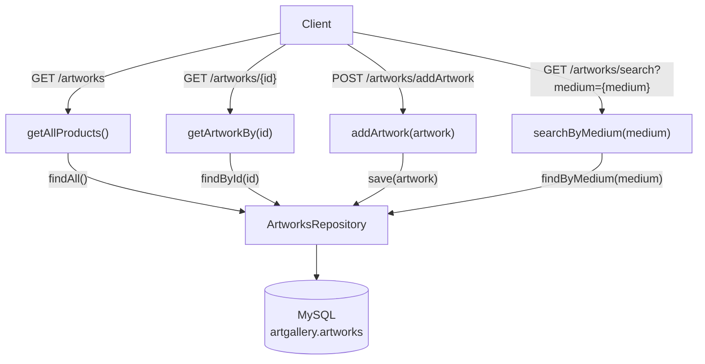

# "Beans&Grounds Coffee Store" API

## Project Overview:

An API to be used to store, update and retrieve data regarding the products sold in a small
company that sells coffee products. 

## Schema:

The API will display the following functionality:
1. retrieve a list of artworks on display;
2. retrieve details of a specific artwork by its ID;
3. add a new product to the Database;
4. search database for artworks of a specific medium.

## Setup/How to Run:
1. Clone this repository to your local repository:
   `git clone https://github.com/yourusername/your-repo-name.git`
2. Configure: copy the application-template.yaml boilerplate into your own application.yaml file.
3. Update the username and password with your own MySql credentials.
4. Create the artgallery database and artworks table (code in resources/artgallery.sql file).
5. Open the cloned project
6. Allow Maven to automatically download dependencies.
7. Go to Assignment2Application.java.
8. Run project. 
