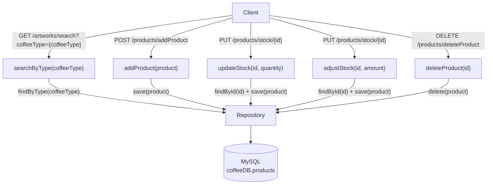

# "Beans&Grounds Coffee Store" API

## Project Overview:

An API to be used to store, update and retrieve data regarding the products sold in a small
independent store that sells coffee products. 

## Initial Backend Design:

The diagram below illustrates the initial backend design of the Coffee application, including the corresponding REST endpoints, service methods, repository interactions, and database.

## Setup/How to Run:
1. Clone this repository to your local repository.
2. Configure: copy the application-template.yaml boilerplate into your own application.yaml file.
3. Update the username and password with your own MySql credentials.
4. Create the coffeeDB database and products table (code in resources/coffeeDB.sql file).
5. Open the cloned project
6. Go to CoffeeApp.java.
7. Run project. 

## API Specification:
Once this repository has been cloned and the application run, you can view the API documentation
at: http://localhost:8080/swagger-ui/index.html#/

## Development Tools/Tech Stack:
### Language(s):
- Java (Java Version: JDK 25 (LTS))
- MySQL

### Frameworks:
- Maven
- Spring Boot

### IDE:
- IntelliJ IDEA

### Dependencies/Plugins:
- Lombok
- Spring Web
- Spring Data JPA
- Spring Doc OpenAPI
- MySQL Driver

### Software
- Postman (REST endpoint testing)
- DBeaver (Database Creation)

