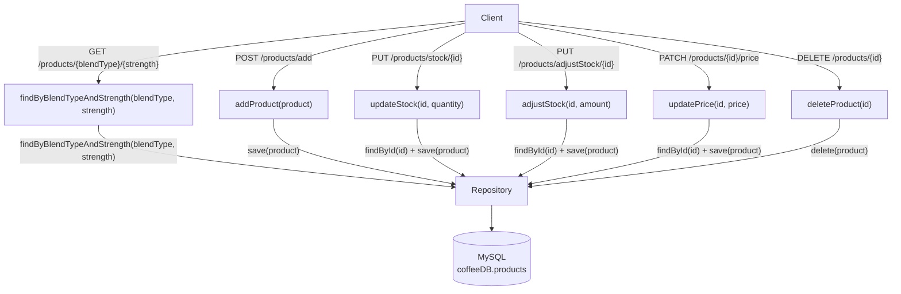

# The "Beans&Grounds Coffee Store" API
   <br>  


## Project Overview:

An API to be used to store, update and retrieve data regarding the products sold in a small
independent store that sells coffee products. 

## Backend Design:
The diagram below illustrates the initial backend design of the Coffee application, including the corresponding REST endpoints, service methods, repository interactions, and database.



## Setup/How to Run:

**Please Note Prior to set up:** 
- If running via Docker (recommended): skip to Step 4 — the database and table are created automatically via `docker-entrypoint-initdb.d.`
- If running locally without Docker: follow Steps 2–3 to manually configure MySQL and run coffeeDB.sql yourself first.
### 1. Clone this repository to your local machine:
    ```
    git clone <https://github.com/Jade-Evans/group-2-project.git>
    cd group-2-project
    ```
### 2. Configure the database credentials:
   The application uses environment variables for the database username and password.

    In IntelliJ:

   - Go to **Run → Edit Configurations**.
   - Select the Spring Boot run configuration.
   - Add the following environment variables:

   ```
   your_sql_username=<your MySQL username>
   your_sql_password=<your MySQL password>
   ```

### 3. Create the 'coffeeDB' database and 'products' table.
   Run the SQL script located in:
    ```
    src/main/resources/coffeeDB.sql
    ```

This creates the `coffeeDB` database and initializes the `products` table.

### 4. Running the application with Docker 
1. Ensure Docker Desktop is installed and running. 
2. Build and start both the application container and MySQL container:
   ```
   docker compose up --build
   ```
3. The application will start on `http://localhost:8080`
4. To stop the containers, run:
   ```
   docker compose down
   ```

### 5. View the API documentation
Once the application is running, Swagger UI is available at: http://localhost:8080/swagger-ui/index.html
    

## Development Tools/Tech Stack
### Languages:
- Java (Java Version: JDK 21)
- MySQL

### Frameworks:
- Maven
- Spring Boot

### Original Development IDE:
- IntelliJ IDEA

### Dependencies:
- **Spring Boot Starter** — to configure Spring Boot automatically & manage dependencies
- **Spring Boot Starter Web** — for building REST APIs and web apps
- **Spring Boot Starter Data JPA** — ORM and database access via Hibernate and Spring Data repositories
- **Spring Boot Starter Test** — support testing via JUnit, Mockito, AssertJ, Spring Test etc.
- **Lombok** — uses annotations to reduce boilerplate code for cleaner code (getters, setters, constructors)
- **MySQL Connector/J** — for MySQL database connection
- **SpringDoc OpenAPI Starter WebMVC UI** — generates interactive OpenAPI documentation
- **JUnit** — unit testing framework
- **JUnit Jupiter** — JUnit 5 testing API
- **Mockito Core** — mocking framework used for unit tests

### Software
- Postman (REST endpoint testing)
- DBeaver (Database Creation)
- Docker Desktop (Containerization)

### Image Credits
- README coffee image: Photo by <a href="https://unsplash.com/@nate_dumlao?utm_source=unsplash&utm_medium=referral&utm_content=creditCopyText">Nathan Dumlao</a> on <a href="https://unsplash.com/photos/top-view-photography-of-heart-latte-coffee-XOhI_kW_TaM?utm_source=unsplash&utm_medium=referral&utm_content=creditCopyText">Unsplash</a>