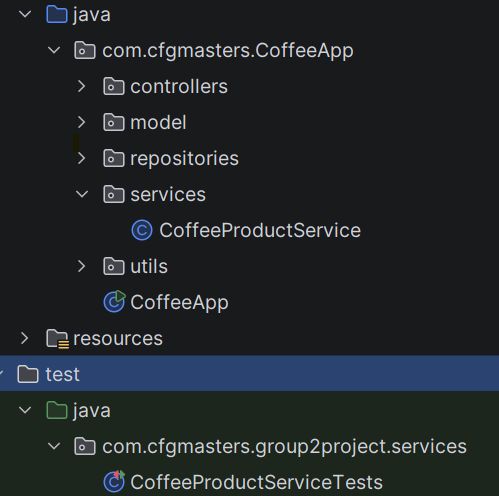
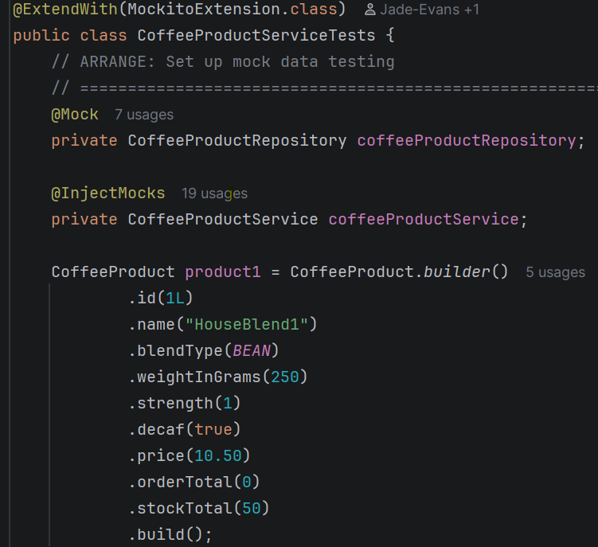

# ✅ Manual Testing Plan

Below we have provided information on the manual testing plan implemented throughout the various stages of development of our group project:

---

## 🎬 Phase 1: Does the Application Start Up Successfully?

We incorporated the following output messages to clearly indicate if the SpringBoot app successfully starts:
```

ConfigurableApplicationContext context = SpringApplication.run(CoffeeApp.class, args);
String serverPort = context.getEnvironment().getProperty("server.port", "8080");
System.out.println("Welcome to the Beans and Grounds Coffee store!");
System.out.println("You can see our API docs at http://localhost:" + serverPort + "/swagger-ui.html");
```

## 🛢️ Phase 2: Does the App Connect to the MySQL Database?

**Manual test:** Use a test GET endpoint i.e. `/hello` in browser to call "Hello from Coffee API".

## ✉️ Phase 3: Manually Test Endpoints Using Postman

Once we had each completed the coding for the endpoint, we each picked an endpoint from another group member and manually tested valid, invalid and boundary inputs. We recorded anything that did/didn't work to be used by each developer to apply robust error handling and later used in unit testing.

Using Postman, we each manually tested each other's endpoints to make sure they worked as we would expect:

### Test Endpoint: `adjustStock()`

- **URL Tested:** `http://localhost:8080/products/adjustStock/1?amount=5`
- **Purpose:** Increase stock level of product with ID 1 by a specified amount.
- **Expected Result:** Stock increases from 50 → 55.
- **Actual Result:** Stock correctly adjusted to 55.


### Test Endpoint: `updateStock()`

- **URL Tested:** `http://localhost:8080/products/updateStock/1?quantity=50`
- **Purpose:** Set the stock level of product with ID 1 to a specific quantity.
- **Expected Result:** Stock resets to 50.
- **Actual Result:** Stock correctly updated to 50.


### Test Endpoint: `findByBlendTypeAndStrength()`

- **URL Tested:** `http://localhost:8080/products/GROUND/3`
- **Purpose:** Search and return coffee products matching both blend and strength.
- **Expected Result:** Products with blend type `GROUND` and strength `3` should be returned.
- **Actual Result:** Four matching products were successfully returned, including Colombian Gold and House Blend products with strength 3 and blend type GROUND.


### Test Endpoint: `addProduct()`

- **URL Tested:** `http://localhost:8080/products`
- **Method:** `POST`
- **Purpose:** To add a new coffee product to the catalogue and store it in the database.
- **Expected Result:** A new coffee product should be created successfully, saved in the database and returned with a generated product ID.
- **Actual Result:** A new product was successfully added. The API returned HTTP 201 Created with the created product details, including the generated ID (61). The product was successfully stored in the MySQL database.

**Response:**

```
{
"id": 61,
"name": "Test Blend",
"weightInGrams": 250,
"strength": 3,
"decaf": false,
"price": 8.99,
"orderTotal": 0,
"stockTotal": 25,
"coffeeType": "BEAN"
}
```


### Test Endpoint: `updatePrice()`

#### Valid price

- **URL Tested:** `http://localhost:8080/products/11/price?price=14.50` *(replace **11** with a valid product ID)*
- **Purpose:** Update only the price of an existing coffee product without modifying any other product details.
- **Expected Result:** The product price is updated while all other product information remains unchanged.
- **Actual Result:** The product price was successfully updated and all remaining fields were unchanged.

#### Invalid price

- **URL Tested:** `http://localhost:8080/products/1/price?price=-5`
- **Method:** `PATCH`
- **Purpose:** Verify that a negative price is rejected.
- **Expected Result:** HTTP 400 Bad Request.
- **Actual Result:** The request was rejected with HTTP 400 Bad Request.

#### Boundary value

- **URL Tested:** `http://localhost:8080/products/1/price?price=0`
- **Method:** `PATCH`
- **Purpose:** Verify that a price of zero is rejected because the price must be greater than zero.
- **Expected Result:** HTTP 400 Bad Request.
- **Actual Result:** The request was rejected with HTTP 400 Bad Request.

#### Product not found

- **URL Tested:** `http://localhost:8080/products/9999/price?price=14.50`
- **Method:** `PATCH`
- **Purpose:** Verify that an update cannot be made to a product that does not exist.
- **Expected Result:** HTTP 404 Not Found.
- **Actual Result:** The API returned HTTP 404 Not Found.


### Test Endpoint: `deleteProduct()`

- **URL Tested:** `http://localhost:8080/products/27`
- **Purpose:** Deletes a coffee product from the catalogue using its ID.
- **Expected Result:** The product with ID 27 should be removed and the API should return HTTP 204 No Content.
- **Actual Result:** Product with ID 27 was successfully deleted and HTTP 204 No Content was returned.


---

## 🧪 Automated Testing Plan

Once the manual tests have been completed, and we are satisfied that the methods all worked with the "happy paths", we move on to creating unit tests using JUnit and Mockito.
Our plan was to follow the below steps:
### 1. Ensure the following are installed as dependencies:
   - **Spring Boot Starter Test** — supports testing via JUnit & Mockito
   - **JUnit** — unit testing framework
   - **JUnit Jupiter** — JUnit 5 testing API
   - **Mockito Core** — mocking framework used for unit tests
### 2. Create a folder structure within the `test` directory
This will mirror the folder structure for the files we want to create unit tests for (in this case, this was the `CoffeeProductService`). Make sure this reflects the naming in
the `main`, apart from the test file having "Test" on the end (i.e. `CoffeeProductServiceTests`).  

<br>
   
### 3. Create a mock database using Mockito, accessible globally from whichever test.  
<br>
   

### 4. Create relevant unit tests corresponding to the methods we had each created, covering the following:

- `findByBlendTypeAndStrength()`
   - Valid uppercase,lowercase,mixed-case, and whitespace input
  - Null, bland and invalid blends
  - Products not found  
  
  
- `addProduct()`
  - Valid product input
  - Bland product name
  - Null blend type
  - Invalid strength
  - Negative price  
  

- `updatePrice()`
  - Valid price updates
  - Negative price validation
  - Zero-price boundary validation
  - Product not found handling  
  

- `deleteProduct()`
  - Valid product deletion
  - product not found handling  
  

- `adjustStock()`
   - Positive stock adjustments
  - Negative stock adjustments
  - Product not found handling
<br>
### 5. Run each automated test to see if they passed or failed.
### 6. Investigate and debug any failed tests.
### 7. Retest and repeat previous step until all tests passed.
### 8. Once satisfied, push to GitHub and create pull request and assign other team members to review and merge.

## CoffeeProductServiceTests — Test Summary
The following unit tests have been added and tested:
### `findByBlendTypeAndStrength()`

| Category | Test Name                                                           | Description                                                       | Status |
|----------|---------------------------------------------------------------------|-------------------------------------------------------------------|--------|
| Valid    | `ValidTypeUpperCase_ReturnsProductsMatchingBlendTypeAndStrength`    | Type passed as `"BEAN"` returns matching products                 | ✅      |
| Valid    | `ValidTypeAllLowerCase_ReturnsProductsMatchingBlendTypeAndStrength` | Type passed as `"bean"` still matches (case-insensitive)          | ✅      |
| Valid    | `ValidTypeMixedCase_ReturnsProductsMatchingBlendTypeAndStrength`    | Type passed as `"BEan"` still matches (case-insensitive)          | ✅      |
| Valid    | `ValidTypeWhiteSpace_ReturnsProductsMatchingBlendTypeAndStrength`   | Type passed as `"  BEAN  "` is trimmed and matches                | ✅      |
| Invalid  | `NullTypeInput_ThrowsBadRequest`                                    | Null type input throws `400 BAD_REQUEST`                          | ✅      |
| Invalid  | `BlankTypeInputWithSpaces_ThrowsBadRequest`                         | Type input of `" "` throws `400 BAD_REQUEST`                      | ✅      |
| Invalid  | `BlankTypeInputNoSpaces_ThrowsBadRequest`                           | Type input of `""` throws `400 BAD_REQUEST`                       | ✅      |
| Invalid  | `InvalidTypeInput_ThrowsBadRequest`                                 | Type input `"BANANA"` (not a valid enum) throws `400 BAD_REQUEST` | ✅      |
| Invalid  | `ValidTypeInputNotFoundInDB_ReturnsNotFound`                        | Type `"GROUND"` (valid enum, no DB match) throws `404 NOT_FOUND`  | ✅      |
| Invalid  | `ValidStrengthInputNotFoundInDB_ReturnsNotFound`                    | Strength `4` (valid, no DB match) throws `404 NOT_FOUND`          | ✅      |
| Invalid  | `StrengthInputGreaterThan5_ThrowsBadRequestException`               | Strength `7` (out of range) throws `400 BAD_REQUEST`              | ✅      |
| Invalid  | `StrengthInputIsNegative_ThrowsBadRequestException`                 | Strength `-5` throws `400 BAD_REQUEST`                            | ✅      |
| Invalid  | `StrengthInputIsNull_ThrowsBadRequestException`                     | Null strength throws `400 BAD_REQUEST`                            | ✅      |
| Edge     | `StrengthValueIs5_ReturnsProductsMatchingBlendTypeAndStrength`      | Upper boundary strength (`5`) returns matching products           | ✅      |

### `updatePrice()`

| Category | Test Name                             | Description                                           | Status |
|----------|---------------------------------------|-------------------------------------------------------|--------|
| Valid    | `ValidPrice_UpdatesAndReturnsProduct` | Valid price updates product and persists via `save()` | ✅      |
| Invalid  | `NegativePrice_ThrowsBadRequest`      | Negative price throws `400 BAD_REQUEST`               | ✅      |
| Invalid  | `ProductNotFound_ThrowsNotFound`      | Non-existent product ID throws `404 NOT_FOUND`        | ✅      |
| Invalid  | `ZeroPrice_ThrowsBadRequest`          | Price of `0.00` throws `400 BAD_REQUEST`              | ✅      |

### `deleteProduct()`

| Category | Test Name                                          | Description                                                      | Status |
|----------|----------------------------------------------------|------------------------------------------------------------------|--------|
| Valid    | `deleteProduct_ValidId_DeletesProduct`             | Existing product ID triggers a successful delete operation       | ✅      |
| Invalid  | `deleteProduct_ProductDoesNotExist_ThrowsNotFound` | Non‑existent ID returns `404 NOT_FOUND` and does not call delete | ✅      |

### `adjustStock()`

| Category | Test Name                                                 | Description                                               | Status |
|----------|-----------------------------------------------------------|-----------------------------------------------------------|--------|
| Valid    | `adjustStock_ValidProductAndAmount_ReturnsUpdatedProduct` | Positive stock adjustment increases total stock correctly | ✅      |
| Valid    | `adjustStock_NegativeAmount_ReturnsUpdatedProduct`        | Negative adjustment decreases stock correctly             | ✅      |
| Invalid  | `adjustStock_ProductDoesNotExist_ThrowsNotFound`          | Non‑existent product ID returns `404_NOT_FOUND`           | ✅      |

## 🎯 Results from Testing
All service tests were then run together to ensure the new validation did not affect existing functionality.

**Result:** 28 tests passed, 0 failed.

