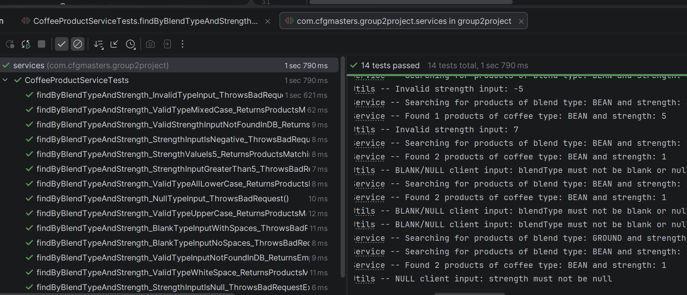

# ✅ Manual Testing Phase

Below we have provided information on the manual testing plan implemented throughout the various stages of development of our group project:

---

## 🎬 Phase 1: Does the Application Start Up Successfully?

We incorporated the following outputgit  messages to clearly indicate if the SpringBoot app successfully starts:
```

ConfigurableApplicationContext context = SpringApplication.run(CoffeeApp.class, args);
String serverPort = context.getEnvironment().getProperty("server.port", "8080");
System.out.println("Welcome to the Beans and Grounds Coffee store!");
System.out.println("You can see our API docs at http://localhost:" + serverPort + "/swagger-ui.html");
```

## 🛢️ Phase 2: Does the App Connect to the MySQL Database?

**Manual test:** Use a test GET endpoint i.e. `/hello` in browser to call "Hello from Coffee API".

## ✉️ Phase 3: Manually Test Endpoints Using Postman

Once we had each completed the coding for the endpoint, we each picked an endpoint from another group member and manually tested valid, invalid and boundary inputs. We recorded anything that did/didn't work to be used by each developer to apply robust error handling and later used in unit testing.

Using Postman, we each manually tested each other's endpoints to make sure they worked as we would expect:

### Test Endpoint: `adjustStock()`

- **URL Tested:** `http://localhost:8080/products/adjustStock/1?amount=5`
- **Purpose:** Increase stock level of product with ID 1 by a specified amount.
- **Expected Result:** Stock increases from 50 → 55.
- **Actual Result:** Stock correctly adjusted to 55.


### Test Endpoint: `updateStock()`

- **URL Tested:** `http://localhost:8080/products/updateStock/1?quantity=50`
- **Purpose:** Set the stock level of product with ID 1 to a specific quantity.
- **Expected Result:** Stock resets to 50.
- **Actual Result:** Stock correctly updated to 50.


### Test Endpoint: `findByBlendTypeAndStrength()`

- **URL Tested:** `http://localhost:8080/products/GROUND/3`
- **Purpose:** Search and return coffee products matching both blend and strength.
- **Expected Result:** Products with blend type `GROUND` and strength `3` should be returned.
- **Actual Result:** Four matching products were successfully returned, including Colombian Gold and House Blend products with strength 3 and blend type GROUND.


### Test Endpoint: `addNewProduct()`

- **URL Tested:** `http://localhost:8080/products`
- **Method:** `POST`
- **Purpose:** To add a new coffee product to the catalogue and store it in the database.
- **Expected Result:** A new coffee product should be created successfully, saved in the database and returned with a generated product ID.
- **Actual Result:** A new product was successfully added. The API returned HTTP 201 Created with the created product details, including the generated ID (61). The product was successfully stored in the MySQL database.

**Response:**

\`\`\`json
{
"id": 61,
"name": "Test Blend",
"weightInGrams": 250,
"strength": 3,
"decaf": false,
"price": 8.99,
"orderTotal": 0,
"stockTotal": 25,
"coffeeType": "BEAN"
}
\`\`\`


### Test Endpoint: `updatePrice()`

#### Valid price

- **URL Tested:** `http://localhost:8080/products/11/price?price=14.50` *(replace **11** with a valid product ID)*
- **Purpose:** Update only the price of an existing coffee product without modifying any other product details.
- **Expected Result:** The product price is updated while all other product information remains unchanged.
- **Actual Result:** The product price was successfully updated and all remaining fields were unchanged.

#### Invalid price

- **URL Tested:** `http://localhost:8080/products/1/price?price=-5`
- **Method:** `PATCH`
- **Purpose:** Verify that a negative price is rejected.
- **Expected Result:** HTTP 400 Bad Request.
- **Actual Result:** The request was rejected with HTTP 400 Bad Request.

#### Boundary value

- **URL Tested:** `http://localhost:8080/products/1/price?price=0`
- **Method:** `PATCH`
- **Purpose:** Verify that a price of zero is rejected because the price must be greater than zero.
- **Expected Result:** HTTP 400 Bad Request.
- **Actual Result:** The request was rejected with HTTP 400 Bad Request.

#### Product not found

- **URL Tested:** `http://localhost:8080/products/9999/price?price=14.50`
- **Method:** `PATCH`
- **Purpose:** Verify that an update cannot be made to a product that does not exist.
- **Expected Result:** HTTP 404 Not Found.
- **Actual Result:** The API returned HTTP 404 Not Found.


### Test Endpoint: `deleteProduct()`

- **URL Tested:** `http://localhost:8080/products/27`
- **Purpose:** Deletes a coffee product from the catalogue using its ID.
- **Expected Result:** The product with ID 27 should be removed and the API should return HTTP 204 No Content.
- **Actual Result:** Product with ID 27 was successfully deleted and HTTP 204 No Content was returned.


---

## 🧪 Rough Notes for Automated Testing

Once the manual tests above have been completed and we aresatisfied that the methods all worked with the "happy paths", we moved on to creating unit tests using JUnit and Mockito.

- We first created a mock database using Mockito, accessible globally from whichever test.
- We created tests corresponding to the endpoint methods we had each created.
- We took into account valid, invalid, and boundary/edge case inputs relevant to each particular method.
- We ran the automated tests to see if they passed or failed.
- We debugged and made amendments where tests failed, and retested until all tests passed.
- Once satisfied with our tests, we pushed to GitHub and requested others in the group to review. 


- ✔ valid inputs
- ✔ input normalisation (case/whitespace)
- ✔ invalid strings
- ✔ invalid strength values
- ✔ boundary value (5)
- ✔ no-results scenario


### `updatePrice()` Unit Tests

Unit tests were added for the `updatePrice()` service method using JUnit and Mockito.

The tests cover:

- Valid price updates
- Negative price validation
- Zero-price boundary validation
- Product not found handling

The repository dependency was mocked using Mockito so that the service method could be tested independently from the MySQL database.

All service tests were then run together to ensure the new validation did not affect existing functionality.

**Result:** 23 tests passed, 0 failed.
